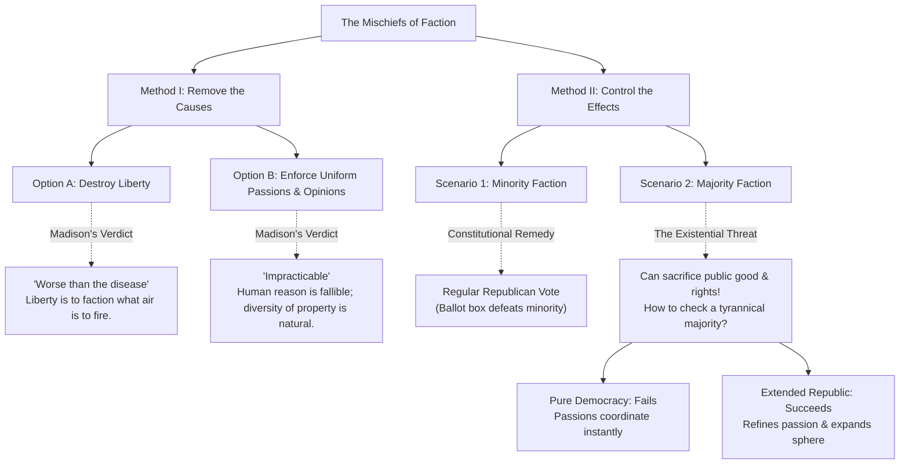
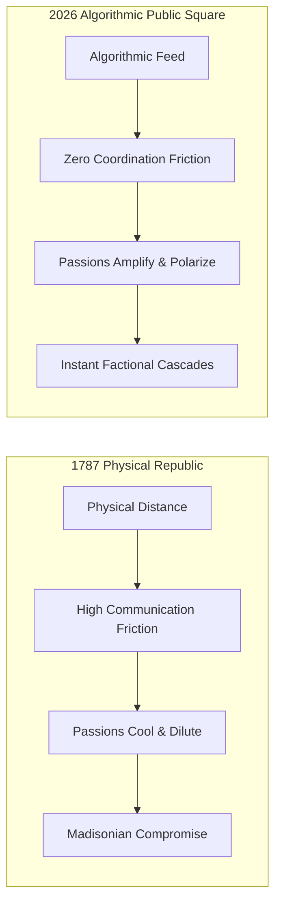

{#title-slip}
# Federalist No. 10
## Factions, the Extended Republic & the Algorithmic Age
### James Madison (November 22, 1787) $\cdot$ The Daily Advertiser (New York)

[Continuous Canvas]{.badge .badge-navy} [Vector Logic Trees]{.badge .badge-crimson} [Spatial Viewport Navigation]{.badge .badge-gold} [Live Inking: 'D']{.badge .badge-green}

A non-linear Digital Humanities masterclass and civic inquiry into the geometry of democratic republics.

*Navigation Guide:*
- Advance step / Glide camera: Spacebar or → / ↓
- Backtrack step: ← or ↑
- Interactive Inking / Canvas Whiteboard: D *(Draw directly over text!)*
- Table of Contents: T

---

{pause up=title-slip}

{#anatomy-section}
# Act I: The Crisis of 1787 & The Anatomy of Faction

In the late autumn of 1787, the fledgling American confederation stood on the verge of dissolution. 
Under the Articles of Confederation, states printed worthless currency, erected tariff barriers against neighbors, and confronted armed agrarian revolts like **Shays' Rebellion (1786)** in Massachusetts.

Madison wrote to answer an urgent question: **How can a free republic survive if the citizens themselves tear it apart?**

{pause}

{.definition title="Madison's Diagnostic Thesis" #madison-thesis}
> "Among the numerous advantages promised by a well-constructed Union, none deserves to be more accurately developed than its tendency to **break and control the violence of faction**."

{pause}

Madison identified factionalism not as an external enemy, but as the **inherent mortal disease** under which popular governments throughout history had everywhere perished.

{pause down=primary-text-box}

## The Primary Source Anchor: Defining the Disease

{#primary-text-box .primary-source-box}
> "By a [faction]{#clause-faction .hl-red}, I understand a number of citizens, whether amounting to a majority or a minority of the whole, who are [united and actuated by some common impulse of passion, or of interest]{#clause-passion .hl-yellow}, [adverse to the rights of other citizens]{#clause-rights .hl-purple}, or to the [permanent and aggregate interests of the community]{#clause-common-good .hl-blue}."
> 
> — **James Madison, Federalist No. 10**

{pause focus=clause-faction}

### Critical Micro-Inspection: What is a Faction?

Notice what Madison **does not** say. 
A faction is **not** simply a modern political party, a club, or a group with differing opinions.

{pause focus=clause-passion}

### Clause 1: "Impulse of Passion or of Interest"
- **Passions:** Visceral emotional triggers—fear, religious zeal, resentment, ethnic tribalism.
- **Interests:** Economic motivations—creditors vs. debtors, agricultural vs. commercial, landowners vs. laborers.

{pause focus=clause-rights}

### Clause 2: "Adverse to the Rights of Other Citizens"
This is the moral dividing line: a faction is defined by its **willingness to sacrifice the rights of fellow citizens** to achieve its own ends.

{pause focus=clause-common-good}

### Clause 3: "Adverse to the Aggregate Interests of the Community"
A faction acts against the long-term survival, stability, and public welfare of the republic as a whole.

{pause unfocus}

---

{pause up=anatomy-section}

{#diagnostic-tree-section}
# Act II: Madison's Diagnostic Tree
## Eliminating the False Remedies

How do we solve this mortal disease? Madison applies rigorous Enlightenment logic, constructing a decision tree that eliminates simplistic answers.

{pause}

{pause}

{.column-2}
> {.remark title="Branch I-A: Destroying Liberty"}
> Madison's most famous scientific metaphor:
> 
> *"Liberty is to faction what **air is to fire**, an aliment without which it instantly expires. But it could not be less folly to abolish liberty, which is essential to political life, because it nourishes faction, than it would be to wish the annihilation of air... because it imparts to fire its destructive agency."*
>
> **Takeaway:** Authoritarian censorship cures faction by killing democracy itself.
>
> {pause}
>
> {.remark title="Branch I-B: Enforcing Uniform Opinions"}
> Why can't we just educate everyone to think alike?
> 
> *"As long as the **reason of man continues fallible**, and he is at liberty to exercise it, different opinions will be formed... The diversity in the faculties of men, from which the rights of property originate, is not less an insuperable obstacle."*
> 
> **Takeaway:** As long as people possess different talents, unequal property and differing interests are inevitable.

{pause down=majority-crisis-box}

{.theorem title="Madison's Uncompromising Conclusion" #majority-crisis-box}
> **The causes of faction cannot be removed.** Relief is only to be sought in the means of **controlling its effects**.
> 
> - **If a faction is a minority:** The republican principle solves it. The majority simply votes them down at the ballot box.
> - **If a faction is a MAJORITY:** The ballot box *enables* tyranny! A passionate majority can vote to strip the minority of their liberty and property.

---

{pause up=diagnostic-tree-section}

{#extended-republic-section}
# Act III: The Geometry of the Extended Republic
## Mathematical & Spatial Institutional Modeling

Why did historical republics (Athens, Rome, Italian city-states) collapse into bloody tyrannies? 
Because they were **Pure Democracies** operating in small geographic spheres.

{pause}

{.column-2}
> {.block title="The Pure Democracy Trap (Small Sphere)"}
> In a small direct democracy:
> - Citizens assemble in one central forum.
> - A common passion or interest is easily communicated to a majority.
> - **Coordination costs are near zero:** The majority discovers their collective power immediately and executes oppression without obstacle.
> 
> > *"Hence it is that such democracies have ever been spectacles of turbulence and contention; have ever been found incompatible with personal security or the rights of property."*
>
> {pause}
>
> {.theorem title="The Extended Republic Remedy (Large Sphere)"}
> Madison inverts classical political philosophy: **Bigger is safer!**
> 
> 1. **Refinement of Representation:** Passing public passion through chosen representatives filters out raw impulse.
> 2. **Multiplicity of Factions:** Extending the geographic sphere takes in so many diverse local interests that a single majority cannot easily coalesce.

{pause}

### Formalizing the Madisonian Institutional Theorem

Slipshow allows us to render the mathematical logic underpinning Madison's constitutional design:

$$\text{Scale of Republic } (\mathcal{S}) \uparrow \implies \text{Diversity of Factions } (|\mathcal{F}|) \uparrow \implies \mathbb{P}(\text{Tyrannical Majority Coordination}) \downarrow$$

{pause}

> {#extended-sphere-quote .primary-source-box}
> "Extend the sphere, and you take in a greater variety of parties and interests; you make it **less probable that a majority of the whole will have a common motive** to invade the rights of other citizens; or if such a common motive exists, **it will be more difficult for all who feel it to discover their own strength, and to act in unison with each other**."
>
> — *James Madison, Federalist No. 10*

{pause focus=extended-sphere-quote}

Notice Madison's two-part physical defense:
1. **Psychological / Motivational Barrier:** Fewer common tyrannical motives.
2. **Friction / Communication Barrier:** Even if the motive exists, geographic distance, mountain ranges, and slow postal riders make simultaneous coordinated action nearly impossible.

{pause unfocus}

---

{pause up=extended-republic-section}

{#historiographical-audit-section}
# Act IV: Historiographical Audit
## The Multi-Perspective Synoptic Slip

Unlike PowerPoint slides that hide conflicting historical voices behind isolated screens, Slipshow lets us evaluate **competing 1787 realities side-by-side**.

{pause}

{.column-3}
> {#fed-col .definition title="The Federalist Position" style="background:#f0fdf4; border-left-color:#16a34a"}
> **James Madison (1787)**
> 
> - **Thesis:** The large republic protects stability, property, and creditor rights.
> - **Representation:** An elite filter of patriotic statesmen checks populist fever.
> - **Core Fear:** Agrarian debt-cancellation, paper-money inflation, and violent factional rebellion.
>
> {pause focus=brutus-col}
>
> {#brutus-col .remark title="The Anti-Federalist Counter" style="background:#fef2f2; border-left-color:#dc2626"}
> **Brutus No. 1 (Robert Yates, 1787)**
> 
> - **Thesis:** A vast republic is an illusion. Free government requires shared manners, habits, and trust.
> - **Representation:** In an extended empire, rulers are alien to citizens; they will pursue private ambition and form a distant oligarchy.
> - **Core Warning:** When territory is too vast for civic affection, laws can only be enforced by **standing armies and federal coercion**.
>
> {pause focus=omitted-col}
>
> {#omitted-col .block title="The Omitted Sovereign" style="background:#f8fafc; border-left-color:#475569"}
> **Enslaved Populace & Disenfranchised Labor**
> 
> - **Historical Reality:** Over 700,000 enslaved Black Americans (~20% of the population) were excluded from Madison's calculus.
> - **Constitutional Irony:** Madison celebrates the defense of "property," but under the 1787 compact, human beings were legally classified as property.
> - **The Three-Fifths Clause:** Granted slaveholding states disproportionate factional leverage in the very Congress meant to filter passion.

{pause unfocus}

---

{pause up=historiographical-audit-section}

{#tiered-scaffolds-section}
# Act V: Tiered Classroom Scaffolding
## AP Government Analysis & ELL Accessible Adaptation

Educators must bridge the gap between complex 18th-century prose and diverse 21st-century learners.

{pause}

{.column-2}
> {.definition title="AP Government Rhetorical Matrix (AP Topic 1.1 / 1.2)"}
> - **Analytical Structure:** Deductive philosophical inquiry based on Enlightenment rationalism (Locke, Hume, Montesquieu).
> - **Institutional Defense:** Justifies Article I (bicameral representation) and the constitutional framework of checks and balances.
> - **AP Exam Key Concept:** The tension between *participatory democracy* (local town halls) and *pluralist / elitist democracy* (Madison's filtered republic).
>
> {pause}
>
> {.example title="7th-Grade Accessible ELL Adaptation"}
> *"People naturally form groups with their friends to get what they want. Sometimes, these groups become greedy and try to hurt others.*
> 
> *We cannot ban these groups without taking away everyone's freedom. If a bad group is small, we simply vote against them. But what if the bad group is the majority?*
> 
> *Madison's answer is simple: In a gigantic country with millions of people and dozens of states, there are too many different groups for any single greedy group to easily take over everything."*

{pause down=vocab-table-container}

### Bilingual Spanish-English Conceptual Lexicon

{#vocab-table-container}
| Archival Term (1787) | Definición en Español | Plain-Language English Meaning | Modern Classroom Example |
| :--- | :--- | :--- | :--- |
| **Faction** | **Facción** | A group united by passion or interest harmful to others | Extremist lobby or polarized online mob |
| **Mischiefs** | **Estragos / Daños** | Violent destruction, chaos, or political instability | Riots, institutional gridlock, civil unrest |
| **Impulse of passion** | **Impulso de pasión** | Sudden visceral rage or emotion driving political acts | Viral outrage sparked by an unverified video |
| **Aggregate interests** | **Intereses de conjunto** | The long-term common good of the whole society | Clean water, public infrastructure, the rule of law |
| **Extended sphere** | **Esfera extendida** | A vast geographic nation containing diverse groups | The continental United States spanning 50 states |

---

{pause up=tiered-scaffolds-section}

{#digital-public-square-section}
# Act VI: The 21st-Century Crucible
## Madison's Extended Republic Meets Algorithmic Feeds

Does James Madison's 1787 constitutional hypothesis survive the internet age?

{pause}

{pause}

### The Breakdown of Spatial Friction

Madison's entire defense of the extended republic depended on an implicit technological assumption: **physical distance slows down human coordination**.

$$\lim_{\text{Communication Latency} \to 0, \, \text{Recommendation Engine} \to \text{Engagement}} \text{Coordination Friction} = 0$$

{pause}

{.remark title="The Algorithmic Inversion"}
When recommender algorithms curate engagement-maximizing feeds:
- Geographic dispersion no longer isolates extremist factions; an isolated individual in rural Florida connects instantly with thousands of ideological peers worldwide.
- Outrage algorithms monetize and artificially manufacture **"impulses of passion"** at the speed of light.
- **The Question:** Did algorithmic social media turn our extended continental republic back into the hyper-volatile mob of an ancient direct democracy?

{pause down=dbq-box}

## Socratic Seminar Document-Based Questions (DBQs)

{#dbq-box .definition title="DBQ Inquiry Prompts for Classroom Deliberation"}
1. **On Technological Assumptions:** Madison argued that an extended republic prevents majority factions because *"it will be more difficult for all who feel it to discover their own strength."* How does social media recommendation design invalidate or alter this claim?
2. **On Property and Power:** Madison identified *"the various and unequal distribution of property"* as the most durable source of faction. In the 21st century, is data and attention capital the new "property" creating modern civic factions?
3. **On Representation:** Did the Founders' model of "refining and enlarging" public views through elected representatives fail to anticipate representatives who use digital media to amplify raw factional outrage rather than cool it?

{pause}

### Socratic Seminar 4-Point Analytical Rubric

| Level | Score | Primary Source Evidence | Historiographical Multi-Perspectivity | Contemporary Application |
| :--- | :---: | :--- | :--- | :--- |
| **Exemplary** | **4** | Cites exact clauses from Federalist No. 10 and *Brutus I* | Synthesizes Madison, Anti-Federalists, and marginalized actors | Integrates network latency, algorithmic amplification, and modern civics |
| **Proficient**| **3** | Accurately explains causes vs. effects of faction | Compares Federalist and Anti-Federalist arguments | Connects 1787 theory to modern political polarization |
| **Developing**| **2** | Summarizes Madison's main point with minor errors | Mentions only one historical perspective | Mentions social media without analyzing institutional mechanics |
| **Beginning** | **1** | Confuses faction with regular political parties | Omits historical counter-arguments entirely | Unsubstantiated personal opinion without textual evidence |

---

{pause up=digital-public-square-section}

{#slipshow-power-section}
# Epilogue: Why Slipshow Over PowerPoint?
## The Digital Humanities Pedagogical Edge

{pause}

{.column-2}
> {.remark title="The PowerPoint Slide Trap"}
> - **Fragmented:** Chops continuous historical thought into arbitrary $16:9$ rectangles.
> - **Static:** Complex branching logic requires tedious manual shape-drawing.
> - **Proprietary & Bloated:** Heavy `.pptx` files requiring commercial subscriptions and software installs.
> - **Black Box:** Binary files that cannot be diffed, version-controlled, or inspected with Git.
>
> {pause}
>
> {.theorem title="The Slipshow Advantage"}
> - **Continuous 2D Canvas:** Camera smoothly glides, pans, and zooms into primary text without jarring transitions.
> - **Code-Defined Diagrams:** Native Mermaid flowcharts rendered directly from plain text.
> - **Zero-Install Portability:** Compiles in 20 seconds via GitHub Actions into a 100% offline-ready single HTML file.
> - **FERPA & Privacy Safe:** Zero student logins, zero advertising trackers, hosted free on GitHub Pages!

{pause center=closing-box}

{.block title="Taking Back Agency: From AI Consumers to Curriculum Architects" #closing-box}
> When educators use AI agents alongside open-source tools like Slipshow and GitHub Pages, we stop being passive consumers of corporate ed-tech. 
> 
> We become **curriculum architects**—authoring rich, inspectable, and accessible civic inquiry materials that belong entirely to us and our students.
> 
> *Press D right now to test the live canvas drawing pen!*
